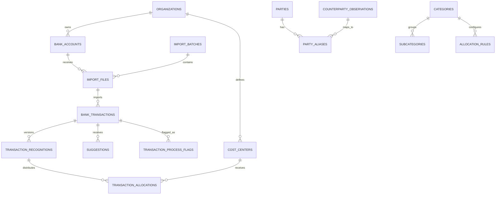

# Modelo de Dados Inicial — Auto Visão Financeiro

**Versão:** 1.0 — 17/11/2026. **Proposta técnica para implementação no Codex**, sujeita à revisão após análise dos primeiros extratos. Preferência técnica sugerida: PostgreSQL, migrações versionadas e identificadores UUID.

## Entidades

| Tabela | Campos principais | Finalidade |
|---|---|---|
| `organizations` | id, name, tax_id? | Empresa/grupo; habilita expansão futura |
| `cost_centers` | id, organization_id, code, name, parent_id?, active | Centros de custos/unidades independentes das contas |
| `bank_accounts` | id, organization_id, bank_code, branch, account_number_masked, holder_name, currency, active | Cadastro de contas bancárias |
| `investment_accounts` | id, bank_account_id?, name, institution, active | Conta de aplicação para conciliar posição financeira (opcional no MVP) |
| `import_batches` | id, imported_by, created_at, status | Importação de múltiplos extratos |
| `import_files` | id, batch_id, bank_account_id, file_name, sha256, format, storage_key, period_start?, period_end?, parser_version | Arquivo fonte e idempotência |
| `bank_transactions` | id, account_id, import_file_id, source_row, bank_external_id?, posted_on, transaction_on?, direction, amount, currency, raw_description, raw_counterparty?, normalized_counterparty?, fingerprint, status | Linha imutável de extrato (valor positivo + direction separado) |
| `counterparty_observations` | id, account_id?, raw_value, normalized_value, first_seen_at, last_seen_at | Pagador/recebedor observado nos extratos |
| `parties` | id, organization_id, type (CUSTOMER/SUPPLIER/BOTH), display_name, tax_id?, active | Cliente/fornecedor mestre |
| `party_aliases` | id, observation_id, party_id, confidence, confirmed_by?, confirmed_at?, source_rule_id?, active | Associação de descrição bancária a cliente/fornecedor |
| `categories` | id, organization_id, code, name, kind, active | Classificação |
| `subcategories` | id, category_id, code, name, active | Subclassificação |
| `transaction_recognitions` | id, bank_transaction_id, party_id?, category_id?, subcategory_id?, notes?, recognition_state, method, confidence?, recognized_by?, recognized_at?, version | Classificação gerencial versionada e contraparte |
| `transaction_allocations` | id, recognition_id, cost_center_id, amount, percentage, allocation_rule_id?, basis_period?, snapshot_json | Distribuições/rateios de valor, sem multiplicar transação bancária |
| `allocation_rules` | id, organization_id, category_id?, subcategory_id?, method, priority, active, valid_from?, valid_to?, config_json | Regra LINEAR / REVENUE_SHARE / FIXED_PERCENT |
| `revenue_bases` | id, organization_id, cost_center_id, period, revenue_amount, closed, source | Base de faturamento para rateio proporcional |
| `recognition_rules` | id, organization_id, account_id?, party_id?, category_id?, subcategory_id?, cost_center_id?, pattern, match_type, priority, threshold?, enabled, version | Reconhecimento determinístico e sugestões |
| `automatic_process_rules` | id, organization_id, bank_account_id?, pattern, process_kind, enabled, priority, valid_from?, valid_to? | Padrões de Processos Automáticos |
| `transaction_process_flags` | id, bank_transaction_id, process_kind, rule_id?, confirmed_by?, confirmed_at?, memo? | Identificação como Processo Automático/transferência interna |
| `transfer_links` | id, out_transaction_id, in_transaction_id, status, confirmed_by? | Vincula transferências entre contas próprias |
| `suggestions` | id, bank_transaction_id, suggestion_kind, payload_json, confidence, reason, model_or_rule_version, status, decided_by?, decided_at? | Sugestões explicáveis e seu resultado |
| `audit_events` | id, actor_id, entity_type, entity_id, action, old_json?, new_json?, created_at | Auditoria rastreável |
| `users` | id, email, display_name, active | Usuários |
| `roles` / `user_roles` | id, name, user_id, role_id | Permissões |
| `monthly_closings` | id, organization_id, period, state, closed_by?, closed_at? | Histórico/controle de fechamento (fase posterior) |
| `cash_forecasts` | id, organization_id, scenario, base_period, generated_at, method, assumptions_json | Projeções versionadas (fase posterior) |

## Principais relacionamentos

## Restrições e invariantes

1. `bank_transactions.amount > 0`, moeda definida; sinal indicado por `direction IN ('CREDIT','DEBIT')`. Evitar erro de dupla inversão.
2. `import_files.sha256` identifica arquivo inteiro, mas **não** substitui identificação por linha para períodos sobrepostos.
3. Preferir identificador único do banco por conta; caso ausente, fingerprint com conta, data, natureza, valor, descrição e outros campos relevantes, com tratamento de colisões e de múltiplos lançamentos legítimos idênticos. Não impor unique ingênuo que descarte pagamentos repetidos.
4. Registro bruto, arquivo de origem e posição da linha não podem ser alterados pela classificação.
5. Uma versão ativa de reconhecimento por transação; versões anteriores mantidas para auditoria.
6. Se classificada e alocada: `SUM(transaction_allocations.amount) = bank_transactions.amount` para a versão de reconhecimento ativa, após ajustes centesimais.
7. `subcategory.category_id` deve corresponder à classificação atribuída.
8. `automatic_process` exclui a linha de agregados **gerenciais**, mas mantém efeitos de conta corrente em saldo bancário bruto.
9. `transfer_links` deve ligar débitos/créditos de contas próprias sem dupla contagem consolidada.
10. Retificação administrativa não deve excluir ou sobrescrever histórico de importação.

## Visões / consultas recomendadas

- `v_bank_balance_movements`: soma C/D do extrato **incluindo** Processos Automáticos.
- `v_operational_cash_movements`: somente movimentos gerenciais elegíveis, **excluindo** Processos Automáticos e transferências internas no consolidado.
- `v_unrecognized_transactions`: pendências com conta, data, valor, descrição e motivo.
- `v_cost_center_cash`: agregação **por alocações**, nunca pela junção direta sem controle para evitar multiplicação.
- `v_cash_basis_pnl`: mapeamento das classificações à DRE de caixa; requer tabela/configuração de linhas DRE para fase futura.

## API inicial sugerida

- `POST /imports/preview` — prévia do extrato e mapeamento do layout.
- `POST /imports/commit` — gravar lote idempotentemente.
- `GET /transactions` — listar e filtrar, com status/sugestões.
- `PATCH /transactions/{id}/recognition` — classificar e/ou associar.
- `POST /party-imports/preview` e `/commit` — importar planilha.
- `POST /counterparties/{id}/link` — vincular observação bancária à entidade.
- `GET/POST /allocation-rules` e `POST /transactions/{id}/allocate`.
- `GET/POST /automatic-process-rules` e `POST /transactions/{id}/mark-automatic`.
- `GET /reports/cash-realized` e `GET /reports/cash-basis-pnl`.

*Esta modelagem orienta a implementação; não é um script SQL executável nem sinaliza que tabelas já foram criadas.*
